  <picture>
    <source media="(prefers-color-scheme: dark)" srcset="https://raw.githubusercontent.com/Anjalihim/Anjalihim/main/dark.svg" />
    <source media="(prefers-color-scheme: light)" srcset="https://raw.githubusercontent.com/Anjalihim/Anjalihim/main/light.svg" />
    
  </picture>

<!-- CONTRIBUTION SNAKE -->
<picture>
  <source media="(prefers-color-scheme: dark)" srcset="https://raw.githubusercontent.com/Anjalihim/Anjalihim/output/github-snake-dark.svg" />
  <source media="(prefers-color-scheme: light)" srcset="https://raw.githubusercontent.com/Anjalihim/Anjalihim/output/github-snake.svg" />
  
</picture>

  

<!-- SOCIAL BADGES (No phone number or Gmail) -->

---

### Hi there, I'm Anjali Kumari 👋
<picture>
  <source media="(prefers-color-scheme: dark)" srcset="https://raw.githubusercontent.com/Anjalihim/Anjalihim/main/intro-dark.svg" />
  <source media="(prefers-color-scheme: light)" srcset="https://raw.githubusercontent.com/Anjalihim/Anjalihim/main/intro-light.svg" />
  
</picture>

---

## 💼 Experience

<picture>
  <source media="(prefers-color-scheme: dark)" srcset="https://raw.githubusercontent.com/Anjalihim/Anjalihim/main/experience-dark.svg" />
  <source media="(prefers-color-scheme: light)" srcset="https://raw.githubusercontent.com/Anjalihim/Anjalihim/main/experience-light.svg" />
  
</picture>
---

### 🚀 Featured Projects
- **E-Commerce Web Application** 
  <picture>
  <source media="(prefers-color-scheme: dark)" srcset="https://raw.githubusercontent.com/Anjalihim/Anjalihim/main/project-ecommerce-dark.svg" />
  <source media="(prefers-color-scheme: light)" srcset="https://raw.githubusercontent.com/Anjalihim/Anjalihim/main/project-ecommerce-light.svg" />
  
</picture>

- **Real-Time Chat Application** 
  <picture>
  <source media="(prefers-color-scheme: dark)" srcset="https://raw.githubusercontent.com/Anjalihim/Anjalihim/main/project-chat-dark.svg" />
  <source media="(prefers-color-scheme: light)" srcset="https://raw.githubusercontent.com/Anjalihim/Anjalihim/main/project-chat-light.svg" />
  
</picture>

- **Task Management System (CRUD)** 
  <picture>
  <source media="(prefers-color-scheme: dark)" srcset="https://raw.githubusercontent.com/Anjalihim/Anjalihim/main/project-tasks-dark.svg" />
  <source media="(prefers-color-scheme: light)" srcset="https://raw.githubusercontent.com/Anjalihim/Anjalihim/main/project-tasks-light.svg" />
  
</picture>

- **Personal Developer Portfolio** 
  <picture>
  <source media="(prefers-color-scheme: dark)" srcset="https://raw.githubusercontent.com/Anjalihim/Anjalihim/main/project-portfolio-dark.svg" />
  <source media="(prefers-color-scheme: light)" srcset="https://raw.githubusercontent.com/Anjalihim/Anjalihim/main/project-portfolio-light.svg" />
  
</picture>
---

### 🛠️ Tech Stack & Tools

<picture>
  <source media="(prefers-color-scheme: dark)" srcset="https://raw.githubusercontent.com/Anjalihim/Anjalihim/main/tools-dark.svg" />
  <source media="(prefers-color-scheme: light)" srcset="https://raw.githubusercontent.com/Anjalihim/Anjalihim/main/tools-light.svg" />
  
</picture>

---

### 📜 Certifications

<picture>
  <source media="(prefers-color-scheme: dark)" srcset="https://raw.githubusercontent.com/Anjalihim/Anjalihim/main/certifications-dark.svg" />
  <source media="(prefers-color-scheme: light)" srcset="https://raw.githubusercontent.com/Anjalihim/Anjalihim/main/certifications-light.svg" />
  
</picture>

 

