<!--
  SETUP: Replace every YOUR-USERNAME with your GitHub username.
  Add repo/demo links to the Projects table later.
  Do NOT add phone number or email anywhere.
-->

  

## About me

Hi, I'm **Anjali Kumari**, a Computer Science undergraduate at **IIT Patna** (CPI 8.56/10). I build full-stack web apps with the MERN stack, Next.js and TypeScript, design RESTful APIs, work with real-time WebSockets, and turn data into dashboards using Python, SQL and Power BI.

## Experience

**Data Analyst Intern, GUVI - HCL Technologies** (Jun 2025 - Aug 2025, Remote)

- Wrote SQL queries and Python scripts to clean and analyze 10,000+ raw data entries with 99% data integrity.
- Built 5+ interactive Power BI dashboards, cutting executive reporting time by 25%.
- Developed automated ETL pipelines with Pandas and NumPy.

## Selected projects

| Project | Highlights | Tech |
|---|---|---|
| **E-Commerce Web App** | JWT auth, cart persistence, Stripe payments, 12+ REST endpoints, 35% faster DB search through MongoDB indexing | React.js, Node.js, Express.js, MongoDB, Stripe, JWT |
| **Real-Time Chat App** | 100+ concurrent WebSocket connections, sub-80ms latency, bcrypt auth | React.js, Node.js, Express.js, Socket.io, MongoDB |
| **Task Management System** | Typed CRUD portal with status filtering, priority sorting, server-side pagination | Next.js, TypeScript, Node.js, Express.js, MongoDB |
| **Developer Portfolio** | 98+ Lighthouse scores for performance, accessibility and SEO | Next.js, React.js, Tailwind CSS, Vercel |

## Skills

- **Languages:** JavaScript (ES6+), TypeScript, Python, SQL, HTML5, CSS3
- **Frameworks and libraries:** React.js, Next.js, Redux Toolkit, Tailwind CSS
- **Databases:** MongoDB, Mongoose, PostgreSQL, MySQL, Firebase
- **Tools:** Git, GitHub, Postman, Power BI, VS Code, npm, Docker (basic)

## Certifications

- GUVI - HCL: Full Stack Web Development and Data Analytics
- WsCube Tech: Data Science, Power BI and Full Stack Web Development

## Contribution heatmap

  

## GitHub stats

  
  

## Connect

- [LinkedIn](https://www.linkedin.com/in/YOUR-LINKEDIN)

  

